# ¿Qué hay en la foto?

Tomas una foto con el teléfono, la subes, y en un par de segundos la aplicación te dice qué ve en ella, con un porcentaje al lado de cada cosa. La foto queda guardada en un bucket de Cloud Storage y aparece en una galería con las últimas fotos del grupo. Quien reconoce lo que hay en la imagen no es código tuyo: es Cloud Vision, un modelo que Google ya entrenó y que se usa con una petición HTTP.

La plantilla trae las dos aplicaciones completas y la infraestructura del frontend y el backend. Tu grupo construye en Terraform el bucket, el permiso del backend sobre él y el acceso a Vision.

| Sin bucket todavía | Con etiquetas | La galería |
|---|---|---|
|  |  |  |

Las capturas salen de una prueba local: Cloud Storage simulado y, en lugar de Vision, un modelo de clasificación pequeño corriendo en el computador. Por eso las etiquetas de las capturas no son las de Vision; las reales las vas a ver cuando lo despliegues.

## Arquitectura al terminar la práctica

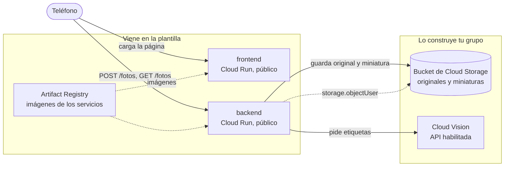

La flecha punteada es el único permiso de IAM que da tu grupo: la cuenta del backend puede crear, leer y listar objetos en ese bucket y en ningún otro. Para llamar a Vision no hace falta ningún rol: basta con que la API esté habilitada en el proyecto y con que el backend corra con una cuenta de servicio del mismo proyecto.

En la plantilla, la variable `BUCKET` del backend está vacía: responde que no tiene dónde guardar y no guarda nada. Es lo primero que vas a ver al desplegar.

## Estructura del repositorio

```
backend/main.py            API en Flask: recibe la foto, hace la miniatura, pide etiquetas y guarda en el bucket
backend/requirements.txt   Dependencias del backend con versión fija
backend/Dockerfile         Imagen del backend con gunicorn
frontend/index.html        La página: subir una foto, ver sus etiquetas y la galería del grupo
frontend/server.py         Servidor sin dependencias que inyecta BACKEND_URL en la página
frontend/Dockerfile        Imagen del frontend
infra/providers.tf         Versión de Terraform y del proveedor de Google
infra/variables.tf         Proyecto, prefijo, región e imágenes
infra/main.tf              APIs, registro, backend y frontend con sus cuentas
infra/storage.tf           Bucket de las fotos, permiso del backend y regla de ciclo de vida
infra/outputs.tf           Ruta del registro y URL de los servicios
infra/terraform.tfvars.example   Ejemplo de valores; cópialo como terraform.tfvars
docs/api.md                Endpoints del backend y cómo se guardan las fotos
docs/capturas/             Capturas de la aplicación usadas en este README
.gitignore                 Deja por fuera el estado de Terraform, tus tfvars y __pycache__
```

## Cómo empezar

### Flujo de trabajo

1. Crea el repositorio de tu grupo con **Use this template** en GitHub.
2. Edita en VS Code o en github.dev (tecla `.` en la página del repositorio).
3. Haz commit y push desde el editor.
4. En Cloud Shell clonas la primera vez y traes los cambios con `git pull` después. Desde Cloud Shell nunca haces push.
5. Docker y Terraform se ejecutan siempre en Cloud Shell. La consola de Google Cloud es para mirar y diagnosticar, no para crear recursos.

### Primer despliegue

En Cloud Shell:

```bash
git clone https://github.com/<tu-usuario>/<tu-repositorio>.git
cd <tu-repositorio>/infra
cp terraform.tfvars.example terraform.tfvars
cloudshell edit terraform.tfvars
```

En `terraform.tfvars` pon el ID de tu proyecto y el prefijo del grupo, y ajusta las rutas de las imágenes a esos mismos valores. Este archivo vive solo en Cloud Shell: el `.gitignore` evita que llegue a GitHub.

El orden importa, porque las imágenes necesitan el registro y los servicios necesitan las imágenes:

```bash
# 1. Solo el registro (y las APIs de las que depende)
terraform init
terraform apply -target=google_artifact_registry_repository.registro

# 2. Las imágenes
REGISTRO=$(terraform output -raw registro)
gcloud auth configure-docker us-central1-docker.pkg.dev --quiet
cd ..
docker build -t $REGISTRO/backend:v1 backend
docker push $REGISTRO/backend:v1
docker build -t $REGISTRO/frontend:v1 frontend
docker push $REGISTRO/frontend:v1

# 3. Todo lo demás
cd infra
terraform apply
terraform output
```

Abre `url_frontend` en el teléfono. Si usas otra región, cambia `us-central1` en el comando de `gcloud auth configure-docker`, y ten en cuenta que la cuota gratuita de Cloud Storage solo aplica en `us-central1`, `us-east1` y `us-west1`.

Cuando cambies el código de un servicio, construye y sube la imagen con una etiqueta nueva (`v2`, `v3`...), actualízala en `terraform.tfvars` y vuelve a aplicar. Si subes otra vez la misma etiqueta, Terraform no ve ningún cambio y Cloud Run sigue con la versión anterior.

## Probar cada servicio con `docker run`

Antes de subir una imagen, pruébala en Cloud Shell. Para ver una página servida en Cloud Shell usa **Vista previa en la Web** y elige el puerto.

**Frontend.** No necesita credenciales:

```bash
docker run --rm -p 8080:8080 -e BACKEND_URL=https://<url-del-backend> $REGISTRO/frontend:v1
```

Abre la vista previa en el puerto 8080. Si no pasas `BACKEND_URL`, la página va a decir que no pudo hablar con el backend.

**Backend sin bucket.** El contenedor arranca aunque no tenga credenciales, y sin la variable `BUCKET` responde con un error claro:

```bash
docker run --rm -d --name backend -p 8081:8080 $REGISTRO/backend:v1
curl -i localhost:8081/fotos
docker logs backend
docker rm -f backend
```

Debe responder `503` con el error en JSON y una advertencia en los registros.

**Backend con bucket.** Cuando el bucket ya existe y la API de Vision está habilitada, puedes darle al contenedor tus propias credenciales:

```bash
gcloud auth application-default login
docker run --rm -d --name backend -p 8081:8080 \
  -e GOOGLE_CLOUD_PROJECT=<tu-proyecto> \
  -e BUCKET=<nombre-del-bucket> \
  -e GOOGLE_APPLICATION_CREDENTIALS=/adc.json \
  -v $HOME/.config/gcloud/application_default_credentials.json:/adc.json:ro \
  $REGISTRO/backend:v1
curl -X POST localhost:8081/fotos -F "autor=Ana" -F "foto=@una-foto.jpg"
curl localhost:8081/fotos
```

Los detalles de cada endpoint están en [docs/api.md](docs/api.md).

---

# Informe del grupo

## Integrantes

| Nombre | Código | Usuario de GitHub |
|---|---|---|
| Angely Sofia Pino | 1152315 | [AngelyDema](https://github.com/AngelyDema) |
| Jhan Ávila Torres | 1152490 | [JhanFranco1152490](https://github.com/JhanFranco1152490) |

## URL de la aplicación

Frontend: https://grupo5-frontend-6bheevwcmq-uc.a.run.app

Las evidencias 0 a 5 se tomaron en el proyecto `nube-practica-1-507220`. Para la evidencia 6 el servicio se destruyó y se volvió a montar desde cero en el proyecto `project-b8ccf4db-b29b-495f-b33`, que es el que sirve esa URL el día de la revisión.

## Diagrama propio

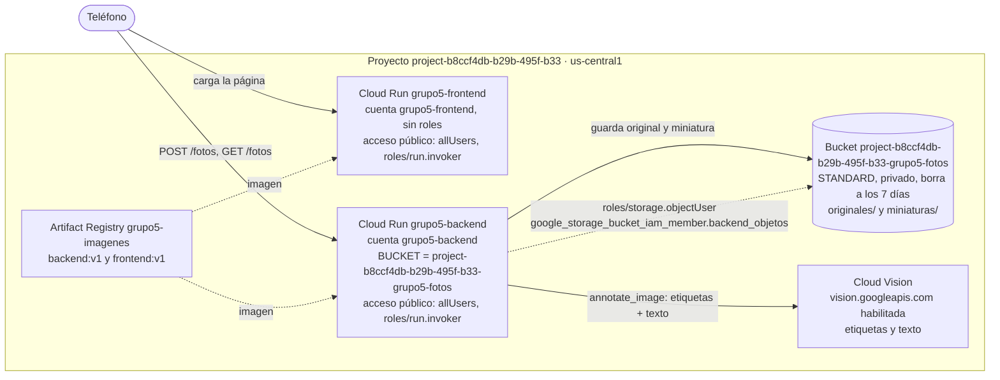

La flecha punteada del backend al bucket es el único permiso de IAM que da el grupo. Vision no lleva ningún rol: basta con la API habilitada en el proyecto (`google_project_service.apis`).

## Evidencias por fase

### Evidencia 0: 

Link del repositorio: https://github.com/AngelyDema/GRUPO5-practica6


Resultado de Gcloud config list: 


### Evidencia 1: 

*Imagenes creadas:*

Backend: 


Frontend: 


Capture de la url frontend: 


### Evidencia 2: 
Bucket: 

Imagen del frontend: 


### Evidencia 3: 

Info del backend: 
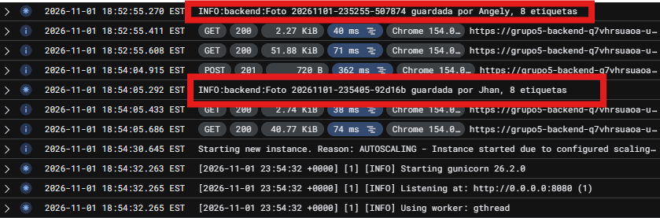

API Vision habilitada: 
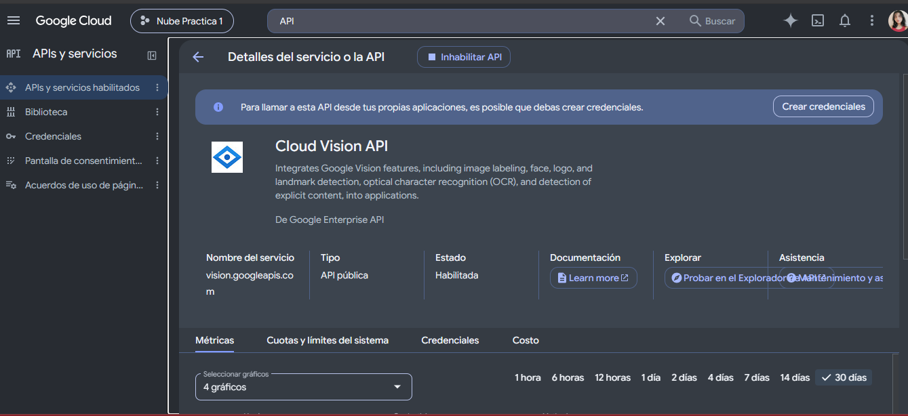

Foto con Etiquetas: 
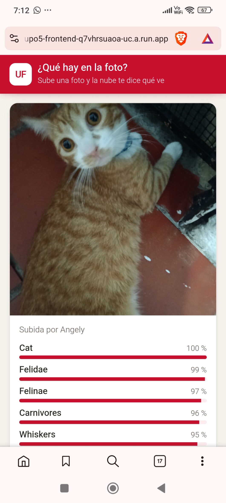

### Evidencia 4: 

| Foto | Etiquetas | Comentario |
|:----:|-----------|------------|
|  | Input device 99 % · Peripheral 99 % · Electronic device 99 % | Me parece correcta la etiqueta |
|  | Sculpture 97 % · Statue 95 % · Monument 85 % | Muy bien asimilados |
| 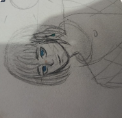 | Facial expression 95 % · Drawing 91 % · Line art 88 % | Acertado |
| 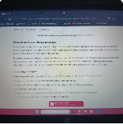 | Electronic device 98 % · Text 97 % · Display device 94 % | Acertado, aunque en mi opinión Text debería ser lo primero antes de Electronic device |
| 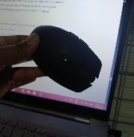 | Input device 99 % · Peripheral 99 % · Electronic device 99 % | La reconoció igual de bien |

### Evidencia 5: 

Originales: 
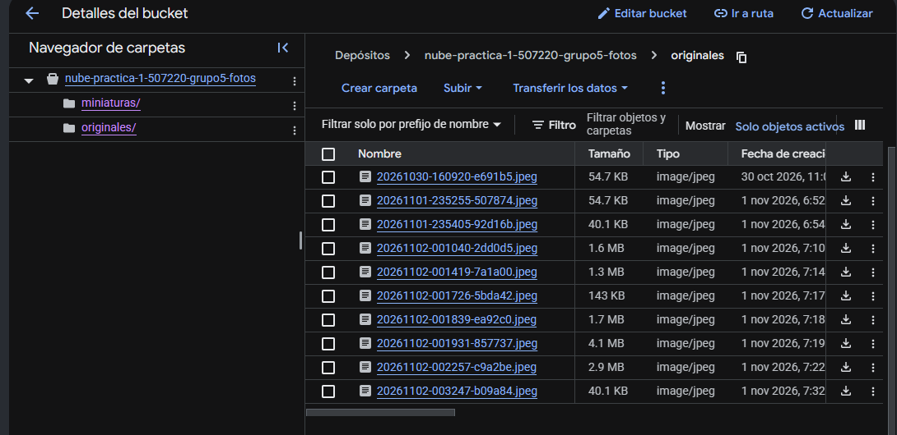

Miniaturas: 
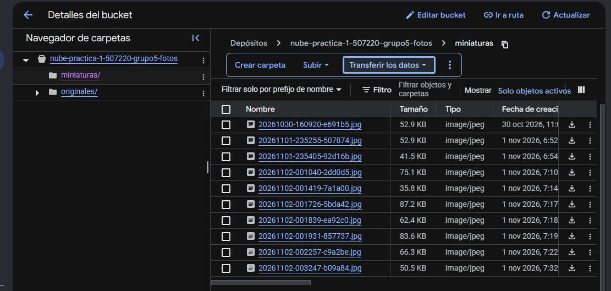

| Foto | Tamaño original | Tamaño miniatura | Diferencia |
|:----:|:---------------:|:----------------:|:----------:|
| 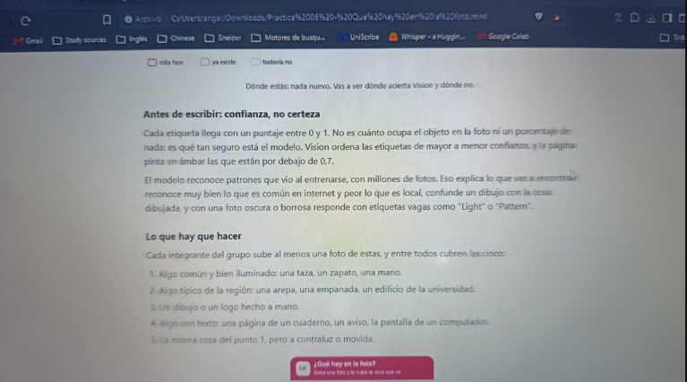 | 4.1 MB | 83.6 KB | ≈ 4.0 MB menos (≈ 98 %) |

Metadatos de una miniatura (autor, etiquetas, texto y estado de Vision), en la captura de la Evidencia 6 tomada en el despliegue final: 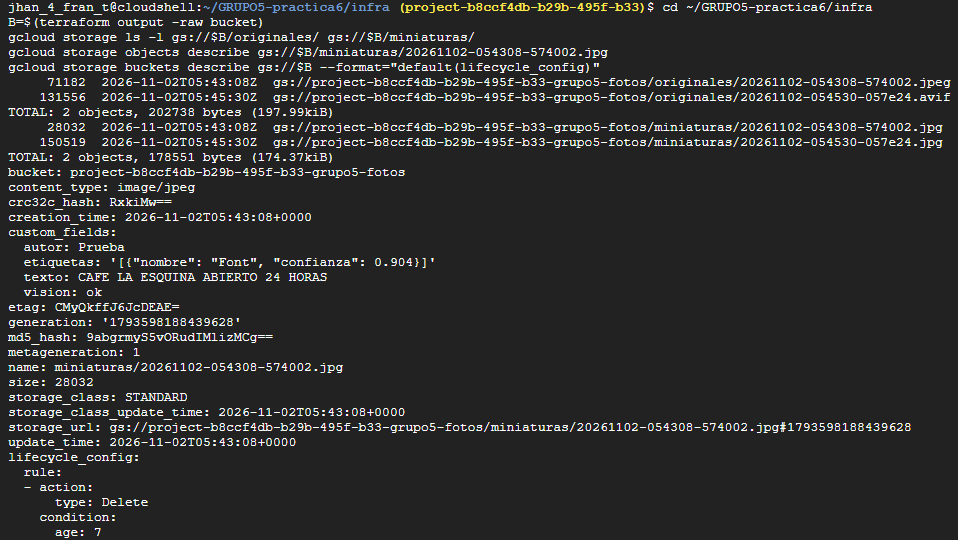

Costo de la salida de datos de Cloud Run (0,19 dólares por GiB) para una galería de 20 fotos vista 100 veces:

| Se envía | Peso por vista | Total en 100 vistas | Costo aproximado |
|----------|:--------------:|:-------------------:|:----------------:|
| Originales (4.1 MB) | ≈ 82 MB | ≈ 8 GB | ≈ 1,5 dólares |
| Miniaturas (83.6 KB) | ≈ 1,7 MB | ≈ 170 MB | ≈ 0,03 dólares |

### Evidencia 6:

**Leer el texto.** El backend ahora le pide a Vision las etiquetas y el texto en una sola petición, y guarda lo leído como el metadato `texto` de la miniatura. La galería muestra el texto entre comillas bajo las etiquetas.

Foto con texto en el teléfono, con "Make each day your masterpiece" leído por Vision:

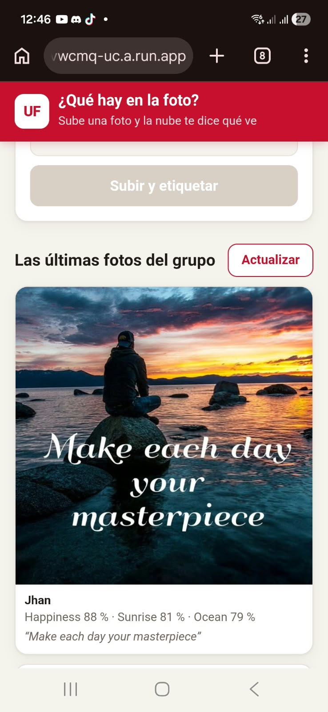

Metadatos de la miniatura en el bucket: se ve `texto`, `etiquetas`, `autor` y `vision`, y al final la regla del bucket:


**Limpieza automática.** La regla vista en la consola del bucket, pestaña Ciclo de vida: borrar objetos con 7 días o más desde su creación.

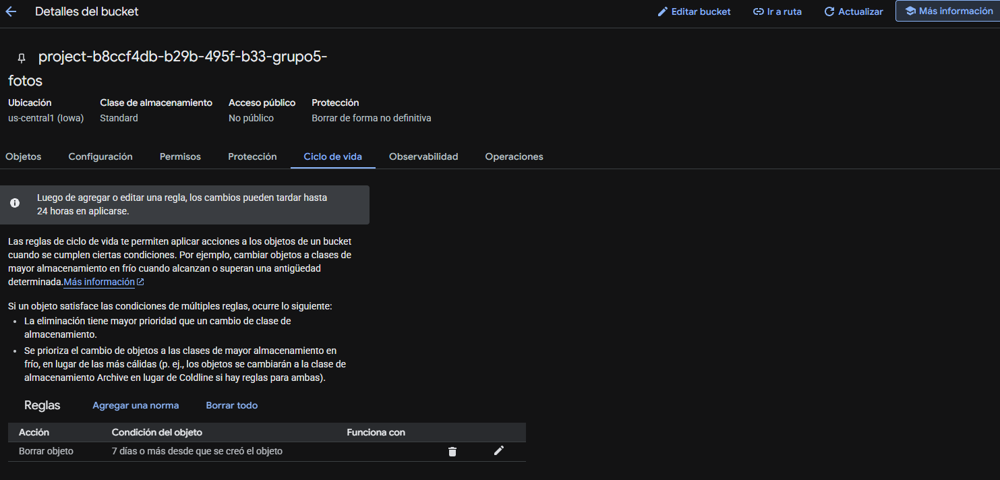

**La cuenta.** Las medidas salen de los 10 objetos del bucket de las evidencias 4 y 5 (capturas `image-16.png` y `image-17.png`): el original promedia ≈ 1,19 MB y la miniatura ≈ 60,8 KB, así que cada foto ocupa ≈ 1,25 MB en el bucket.

| Cuota gratuita al mes | Límite | Lo que gasta una foto | Fotos al mes |
|---|:---:|---|:---:|
| Unidades de Vision | 1.000 | 2 (etiquetas + texto) | **≈ 500** |
| Operaciones de clase A | 5.000 | 3 (subir el original, subir la miniatura y el listado de la galería al terminar) | ≈ 1.666 |
| Espacio | 5 GB | ≈ 1,25 MB | ≈ 3.990 acumuladas |
| Salida de datos de Cloud Run | no tiene | una galería de 24 miniaturas son ≈ 1,5 MB | no se agota: se paga, ≈ 0,0003 dólares por vista |

La cuota que se agota primero es la de Vision: con 2 unidades por foto, 1.000 unidades alcanzan para 500 fotos al mes.

**Reproducir.** `terraform destroy` borró los 14 recursos:

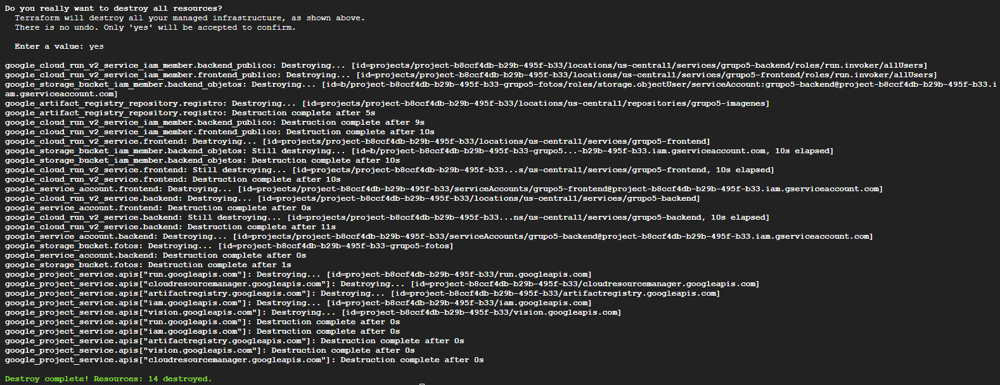

Al reconstruir, los dos `docker push` fallaron varias veces con `connection refused` contra Artifact Registry. Como el primer `terraform apply` se lanzó antes de que estuvieran las imágenes, Cloud Run no encontró `backend:v1`, el servicio quedó marcado como *tainted* y el siguiente `apply` lo reemplazó:

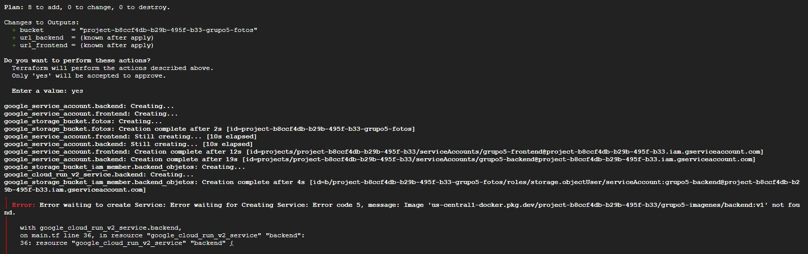

Con las dos imágenes en el registro, el `apply` terminó y la URL del frontend quedó igual que antes:

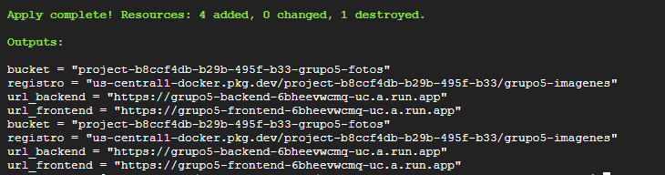

La aplicación funcionando después de reproducir, subiendo la misma foto con texto:

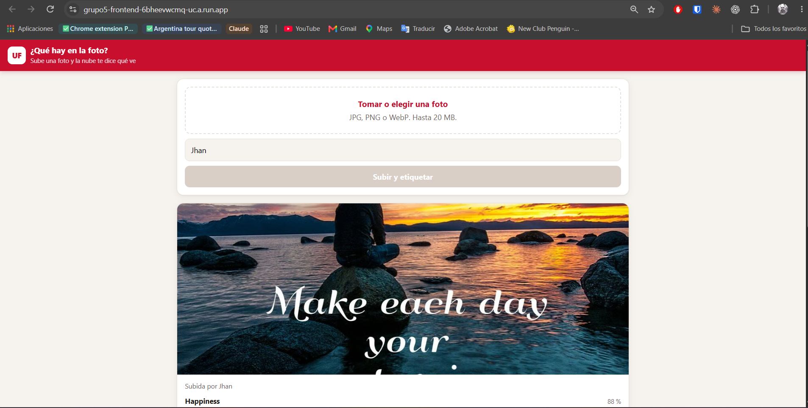

## Decisiones del reto

**Qué cambié.** En [backend/main.py](backend/main.py), `etiquetar` pasó a `analizar`: una sola llamada `annotate_image` con `LABEL_DETECTION` y `TEXT_DETECTION`, que devuelve etiquetas y texto. En [infra/storage.tf](infra/storage.tf) agregué `lifecycle_rule` con `age = var.dias_retencion` (7 por defecto, en [infra/variables.tf](infra/variables.tf)). El [frontend](frontend/index.html) pinta el texto y [docs/api.md](docs/api.md) describe el campo nuevo.

**Cómo muestro el texto.** Se guarda en el metadato `texto` de la miniatura, en una sola línea (los saltos de línea y espacios repetidos se colapsan) y con un máximo de 500 caracteres; si es más largo termina en `…`. Los metadatos personalizados de un objeto admiten unos 8 KiB en total, y las etiquetas ocupan menos de 1 KiB, así que 500 caracteres (como mucho ≈ 2 KB en UTF-8) caben de sobra. Cuando Vision no encuentra texto, o cuando no responde, se guarda una cadena vacía: la API devuelve `texto: null` y la galería no pinta ningún bloque. Pedir las dos funciones en una sola petición no cambia el costo (siguen siendo 2 unidades), pero ahorra una llamada de red por foto.

**La edad de la regla: 7 días.** Con 1 día, una foto subida la noche antes de la revisión podría desaparecer antes de que la vean, y como Cloud Storage evalúa las reglas una vez al día el borrado ocurre en un momento que no controlamos. Con 30 días se guardan fotos de personas más tiempo del necesario y se acumula espacio sin que la práctica lo pida. Siete días cubren la semana del reto y mantienen el bucket pequeño. La edad se cuenta desde la creación de cada objeto: una foto subida el día en que corre la regla no se borra hasta cumplir los 7 días completos. El original y la miniatura se crean con segundos de diferencia, así que pueden caer en pasadas distintas de la regla; es inofensivo porque los originales nunca se sirven. Hay otro detalle: el bucket tiene el borrado no definitivo activo (7 días por defecto, visto en el plan del `destroy`), de modo que un objeto que la regla borra sigue ocupando espacio facturable otros 7 días. Para comprobar que la regla funciona sin esperar una semana habría que aplicar con `-var dias_retencion=1`, subir una foto y revisar que el objeto haya desaparecido a los 1 o 2 días.

**Qué cuota se agota primero.** La de Vision, con ≈ 500 fotos al mes. Los números son la tabla de la Evidencia 6: las medidas de peso salen de los objetos reales del bucket de las evidencias 4 y 5, las 2 unidades por foto del código (`LABEL_DETECTION` y `TEXT_DETECTION`) y los límites de 1.000 unidades, 5.000 operaciones de clase A y 5 GB de los de la guía. Se asume el criterio de la guía, 1.000 unidades gratis en total; si la página de precios de Vision cuenta 1.000 gratis por cada función, el límite subiría a ≈ 1.000 fotos y la que se agotaría primero sería la de clase A. Con la regla de 7 días el espacio nunca se acumula: 500 fotos al mes ocupan ≈ 625 MB.

**Cómo reproduzco.** El orden es el de siempre, porque cada paso necesita el anterior: `terraform apply -target` sobre el registro (arrastra las APIs), `docker build` y `docker push` de las dos imágenes, y `terraform apply` del resto. Con el registro vacío, el servicio de Cloud Run no puede arrancar. El bucket se pudo recrear con el mismo nombre en 2 segundos, sin ninguna espera. La URL del frontend quedó idéntica, porque depende del proyecto y del nombre del servicio. Los problemas reales fueron dos: los `docker push` con `connection refused` (se resolvieron repitiendo el push en un bucle hasta que pasó; el backend subió al cuarto intento y el frontend necesitó varias tandas) y que el primer `apply` se lanzó sin las imágenes, lo que dejó el servicio del backend *tainted* y obligó a reemplazarlo en el siguiente `apply`. Sin `force_destroy = true`, el `destroy` habría fallado en el bucket con las fotos adentro, pidiendo vaciarlo antes (por ejemplo con `gcloud storage rm -r`).

## Preguntas

**¿Por qué la foto de la fase 2 sigue sin etiquetas después de habilitar Vision, y qué tendría que cambiar en el backend para que las tuviera?** Porque el backend solo le pregunta a Vision una vez, dentro de `POST /fotos`, y escribe el resultado como metadato de la miniatura en esa misma subida. Ninguna otra ruta vuelve a mirar una foto ya guardada: `GET /fotos` solo lee los metadatos que hay. La foto de la fase 2 quedó con `vision: error: ...` y `etiquetas` vacío, y así se queda. Para que las tuviera, el backend necesitaría una operación que reprocese: por ejemplo `POST /fotos/<id>/etiquetar`, que descargue la miniatura, llame a `analizar` y actualice los metadatos con `blob.patch()`. Costaría 2 unidades de Vision y una operación de clase A por foto. Hacerlo automáticamente al listar sería peor: cada listado gastaría unidades de Vision y volvería lenta la galería.

**Si le quitan el permiso `storage.objectUser` a la cuenta del backend, ¿qué deja de funcionar, qué ve el usuario y dónde encontrarían el error?** Dejan de funcionar el listado y las subidas, porque toda operación sobre objetos del bucket (listar, crear, leer) devuelve `403`. El contenedor sigue arrancando, porque los clientes de Storage se crean en el primer uso, y el frontend sigue cargando, porque lo sirve otro servicio sin relación con el bucket. El usuario ve la página, pero la galería muestra un aviso con "El backend respondió 500" y, al subir una foto, el formulario muestra ese mismo error. Peor todavía, la foto no se guarda, aunque Vision ya haya gastado sus unidades, porque se llama antes de subir. El error se encuentra en los registros del servicio `grupo5-backend` en Cloud Run (Cloud Logging): un `Forbidden: 403` de Storage que dice que la cuenta del backend no tiene `storage.objects.list` o `storage.objects.create` sobre el bucket. Hay que recordar que un permiso recién dado o quitado tarda un minuto en propagarse.

**¿Por qué el backend le manda a Vision la miniatura y no el original? Den dos razones distintas.** La primera es el tamaño: la miniatura de 1024 píxeles pesa decenas de KB y el original puede pesar varios MB, así que la petición sale más rápido y se mantiene lejos del límite de tamaño que Vision pone a cada petición (unos 10 MB en JSON, según su documentación, con la imagen en base64). Para detectar etiquetas, además, más píxeles no mejoran el resultado. La segunda es que la miniatura ya está normalizada: pasó por `exif_transpose` y `convert("RGB")` y es siempre un JPEG derecho. Los originales llegan en el formato que mande el teléfono y a veces acostados; en nuestro propio bucket, por ejemplo, un original quedó guardado como `.avif`, un formato que Vision no lista entre los que acepta. Mandar la miniatura evita errores por formato y por orientación.
